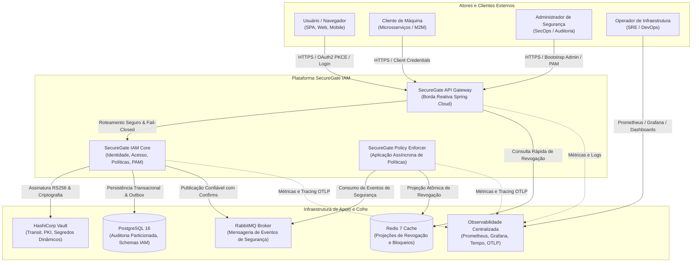
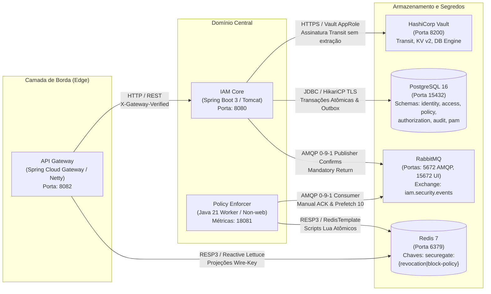
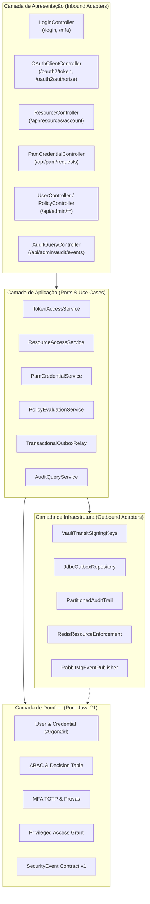
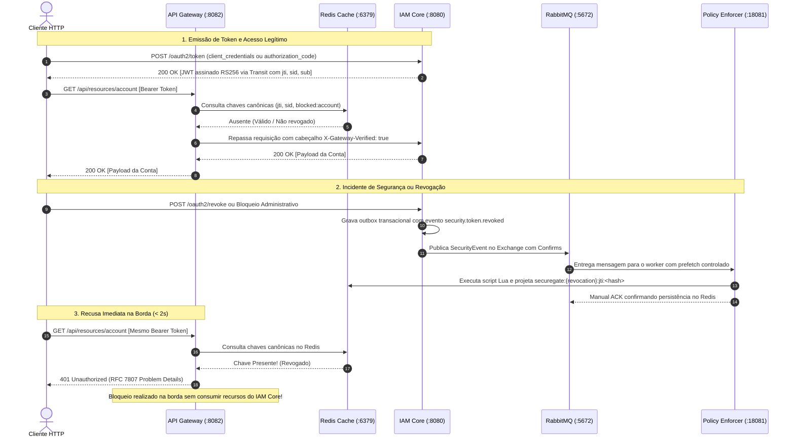

# Visão Geral da Arquitetura do SecureGate IAM

- **Status:** Consolidado (Versão 1.0.0 + Gateway de Borda)
- **Data:** 25/10/2026
- **Escopo:** Mapeamento C4 (Contexto, Contêineres, Componentes e Fluxo de Dados) de todo o ecossistema.

---

## 1. Nível 1: Diagrama de Contexto de Sistema (C4 Context)

O SecureGate IAM é uma plataforma corporativa Zero Trust de Gestão de Identidade, Acesso e Autorização Contínua, projetada para desacoplar custódia criptográfica, decisão de políticas e aplicação distribuída.

---

## 2. Nível 2: Diagrama de Contêineres (C4 Container)

Detalhamento dos nós computacionais, portas, protocolos e responsabilidades de comunicação:

---

## 3. Nível 3: Arquitetura de Componentes do IAM Core (C4 Component)

O `iam-core` adota arquitetura hexagonal estrita orientada a contextos delimitados (DDD):

---

## 4. Fluxo de Decisão Zero Trust e Revogação Contínua

Demonstração do ciclo de vida completo de uma requisição com verificação precoce em borda e propagação assíncrona de revogação:

---

## 5. Diretrizes de Resiliência e Fail-Closed

1. **Falha de Dependência Redis no Gateway:** O Gateway adota estritamente *Fail-Closed*. Se o Redis estiver indisponível ou ocorrer timeout de rede, a requisição é recusada imediatamente com `HTTP 503 Service Unavailable`, impedindo que tokens revogados transitem.
2. **Falha de Broker RabbitMQ:** O `iam-core` utiliza a tabela transacional `security_outbox` no PostgreSQL. Falhas momentâneas do RabbitMQ não provocam perda de eventos; o publicador reexecuta com backoff exponencial assim que o broker for restabelecido.
3. **Falha do HashiCorp Vault:** Assinaturas criptográficas e concessões PAM exigem o Vault online. Diante de indisponibilidade do Vault, nenhuma operação privilegia chaves locais em memória; a emissão falha com segurança (*Fail-Closed*).
