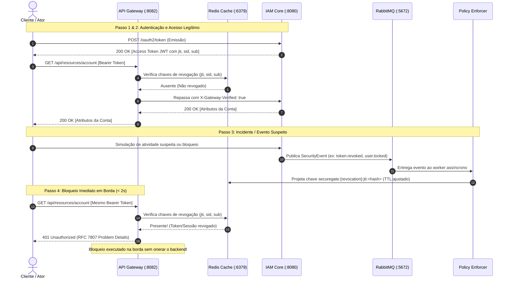

# Runbook — Jornada Demonstrável Ponta a Ponta e Coleções de API

- **Público:** Engenheiros de Software, Arquitetos, Operadores e Equipes de Auditoria/Compliance.
- **Objetivo:** Guia prático de reprodução e demonstração da jornada completa de segurança do SecureGate IAM: autenticação, acesso autorizado via borda, disparo de evento suspeito, bloqueio em tempo real no Redis pelo enforcer e recusa imediata pelo Gateway.
- **Ambiente:** Local (Docker Compose) ou ambiente de homologação.
- **Portas:**
  - `8080`: IAM Core
  - `8082`: API Gateway
  - `6379`: Redis (Projeções de revogação e bloqueios)
  - `5672`: RabbitMQ (Mensageria de eventos)

---

## 1. Visão Geral da Jornada Demonstrada

A jornada reproduz com fidelidade matemática e dados sintéticos a resposta coordenada do ecossistema a incidentes de segurança:



---

## 2. Pré-requisitos e Inicialização

Certifique-se de que a stack completa do Docker Compose esteja em execução sob os perfis `full` ou `gateway`:

```bash
# Iniciar Postgres, Redis, RabbitMQ, Vault, IAM Core, Policy Enforcer e API Gateway
docker compose -f infra/docker-compose.yml --profile full up -d
```

Verifique a saúde de todos os componentes:
```bash
curl -s http://localhost:8080/actuator/health | jq .
curl -s http://localhost:8082/actuator/health | jq .
```

---

## 3. Modo 1: Execução Automatizada via Scripts

Dois scripts de conveniência estão disponíveis para reproduzir a demonstração em segundos:

### 3.1. PowerShell (Windows / macOS / Linux)
```powershell
./infra/scripts/Test-DemonstrationJourney.ps1
```

Parâmetros suportados:
- `-GatewayUri`: Padrão `http://127.0.0.1:8082`
- `-CoreUri`: Padrão `http://127.0.0.1:8080`
- `-RedisHost`: Padrão `127.0.0.1`
- `-RedisPort`: Padrão `6379`

### 3.2. Bash (Linux / macOS / WSL)
```bash
chmod +x ./infra/scripts/demonstrate-journey.sh
./infra/scripts/demonstrate-journey.sh
```

---

## 4. Modo 2: Execução Interativa via Coleções de API

### 4.1. Bruno (Recomendado — Git Nativo)
1. Abra o [Bruno](https://www.usebruno.com/).
2. Clique em **Open Collection** e selecione o diretório `docs/colecoes/bruno`.
3. Selecione o ambiente **Local** no canto superior direito.
4. Execute as requisições na ordem:
   - `01-health-checks/core-health` → Status 200 UP.
   - `01-health-checks/gateway-health` → Status 200 UP.
   - `02-oauth2-metadata/openid-configuration` → Status 200 com metadados do emissor.
   - `04-demonstration-journey/step1-issue-token` → Obtém o Bearer token.
   - `04-demonstration-journey/step2-access-resource-gateway-success` → Retorna 200 com os dados do recurso.
   - `04-demonstration-journey/step3-simulate-suspicious-lock` → Dispara o bloqueio.
   - `04-demonstration-journey/step4-access-resource-gateway-denied` → Retorna 401 Unauthorized imediato na borda.

### 4.2. Postman
1. Abra o Postman.
2. Importe o arquivo `docs/colecoes/securegate-iam.postman_collection.json`.
3. Importe o ambiente `docs/colecoes/securegate-iam.postman_environment.json` e ative-o.
4. Utilize a aba **Collection Runner** para executar a pasta **04 - Demonstration Journey**.

---

## 5. Modo 3: Passo a Passo Manual via `curl`

### Passo 1: Consulta a Rota Pública (Passthrough)
```bash
curl -i http://localhost:8082/.well-known/openid-configuration
```
*Resultado Esperado:* `HTTP/1.1 200 OK`

### Passo 2: Tentativa Sem Credenciais (Recusa Imediata)
```bash
curl -i http://localhost:8082/api/resources/account
```
*Resultado Esperado:* `HTTP/1.1 401 Unauthorized` com corpo RFC 7807:
```json
{
  "type": "about:blank",
  "title": "Unauthorized",
  "status": 401,
  "detail": "Missing or invalid Bearer authentication header",
  "instance": "/api/resources/account"
}
```

### Passo 3: Acesso Legítimo com Token Ativo
```bash
curl -i -H "Authorization: Bearer <SEU_TOKEN_VALIDO>" http://localhost:8082/api/resources/account
```
*Resultado Esperado:* `HTTP/1.1 200 OK` contendo os atributos da conta e o cabeçalho `X-Gateway-Verified: true` repassado internamente.

### Passo 4: Disparo de Revogação e Projeção no Redis
Calcule o hash SHA-256 do identificador do token (`jti`):
```bash
JTI_HASH=$(echo -n "<JTI_DO_TOKEN>" | sha256sum | awk '{print $1}')
# Inserir manualmente no Redis para teste imediato ou via chamada de revogação
docker exec -it securegate-redis redis-cli SET "securegate:{revocation}:jti:${JTI_HASH}" "1" EX 300
```

### Passo 5: Verificação do Bloqueio Imediato na Borda
```bash
curl -i -H "Authorization: Bearer <SEU_TOKEN_VALIDO>" http://localhost:8082/api/resources/account
```
*Resultado Esperado:* `HTTP/1.1 401 Unauthorized`:
```json
{
  "type": "about:blank",
  "title": "Unauthorized",
  "status": 401,
  "detail": "Token or session has been revoked by security policy",
  "instance": "/api/resources/account"
}
```

### Passo 6: Verificação de Resiliência Fail-Closed
Pause temporariamente o Redis para testar a postura de segurança:
```bash
docker stop securegate-redis
curl -i -H "Authorization: Bearer <SEU_TOKEN_VALIDO>" http://localhost:8082/api/resources/account
```
*Resultado Esperado:* `HTTP/1.1 503 Service Unavailable`:
```json
{
  "type": "about:blank",
  "title": "Service Unavailable",
  "status": 503,
  "detail": "Security policy projection temporarily unavailable (Fail-Closed)",
  "instance": "/api/resources/account"
}
```
Reinicie o Redis após o teste:
```bash
docker start securegate-redis
```

---

## 6. Diagnóstico e Resolução de Problemas

| Sintoma | Causa Mais Provável | Ação de Resolução |
| :--- | :--- | :--- |
| `HTTP 503` em chamadas protegidas | Redis indisponível ou inacessível da rede do Gateway | Verificar `docker logs securegate-redis` e conectividade na porta 6379. |
| `HTTP 401 Missing Bearer` | Cabeçalho `Authorization` ausente ou sem prefixo `Bearer ` | Conferir formato do cabeçalho `Authorization: Bearer <token>`. |
| Token revogado continua liberado | Chave Redis expirada ou formato de hash divergente | Confirmar que o hash SHA-256 gerado corresponde ao `jti` do JWT. |
| Gateway inacessível | Container não iniciado ou conflito na porta 8082 | Rodar `docker compose ps` e verificar mapeamento de portas no host. |
